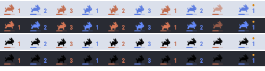
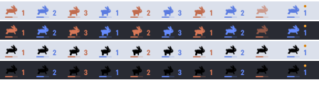
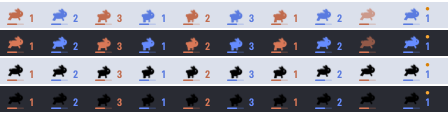
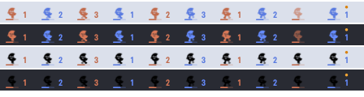

# Menu bar runners

Free animated runners for macOS menu bar apps that accept custom PNG frames, such as **[RunCat](https://kyome.io/runcat/)** (custom runner) and **[Lidnight](https://lidnight.app/en/)** (Settings › Menu bar › Custom — a Pro feature, included in the 7-day trial).

Every runner here follows the same spec, so it works in either app:

- PNG, **36 px tall**, 10–100 px wide (all frames the same width)
- black silhouette with transparency, so the app can tint it (template / monochrome mode)
- frames in order for one full stride: `name-0.png`, `name-1.png`, …

| Runner | Frames | Preview |
|---|---|---|
| [Moon-tail bunny](runners/moon-tail-bunny) | 8 × 42 px |  |
| [Hop bunny](runners/hop-bunny) | 8 × 42 px |  |
| [Mochi bunny](runners/mochi-bunny) | 8 × 38 px |  |
| [Moon runner](runners/moon-runner) | 8 × 36 px |  |

The previews show each runner in template mode (tinted per AI) and original mode, light and dark, as drawn by Lidnight's menu bar.

## Use it

**Lidnight** (Pro, included in the 7-day trial): Settings › Menu bar › Custom › Add a runner… → pick all PNGs of one folder → Add. Template mode gives each AI agent its own color.

**RunCat**: Settings › Runner › Custom runner › Add → pick the frames in order.

Download one folder with:

```sh
git clone --depth 1 https://github.com/whereisdw/menubar-runners
```

## Add your own

Pull requests welcome. Keep the spec above, one folder per runner under `runners/`, your own artwork only (no ripped game or brand characters), and say in the PR which license applies (CC0 preferred).

## License

The runners in this repository are released under [CC0 1.0](LICENSE): use them anywhere, no attribution needed. They are drawn from Lidnight's built-in bunnies.

---

### 한국어
RunCat·Lidnight 처럼 PNG 프레임으로 메뉴바 러너를 바꿀 수 있는 앱에서 쓰는 무료 러너 모음입니다. 규격: PNG · 높이 36px · 너비 10~100px(모두 같게) · 검은 실루엣 + 투명(앱이 색을 입힘) · 한 바퀴 순서대로. Lidnight 은 설정 › 메뉴바 › 사용자 러너 › 새 러너 추가… 에서 한 폴더의 PNG 를 모두 고르면 됩니다(Pro 기능, 7일 체험 포함). CC0(자유 이용).

### 日本語
RunCat や Lidnight のように PNG フレームでメニューバーのランナーを変えられるアプリ向けの無料ランナー集です。規格: PNG・高さ 36px・幅 10〜100px（すべて同じ）・黒いシルエット＋透明（アプリが色をつける）・1 周を順番に。Lidnight は 設定 › メニューバー › カスタム › ランナーを追加… でフォルダ内の PNG をすべて選びます（Pro 機能・7 日間の体験に含まれます）。CC0。
